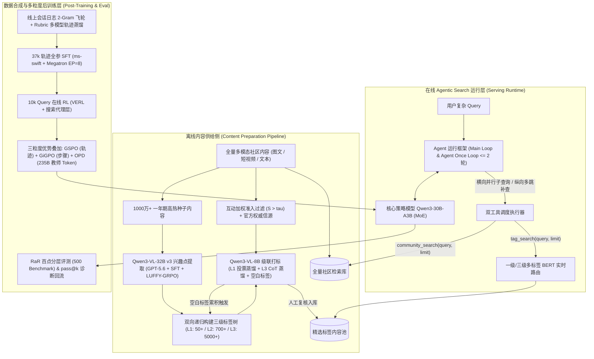
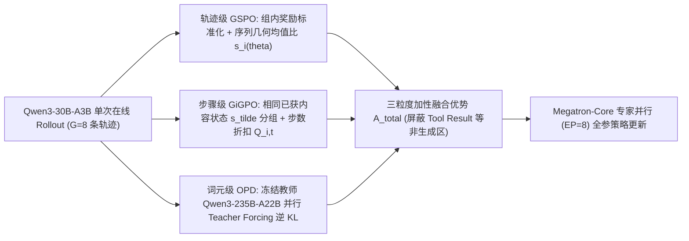

# 《Large Language Models》课程项目 Proposal

## 项目名称
**基于标签增强双供给链路与多粒度强化学习的内容社区低时延 Agentic Search 系统**  
*Tag-Enhanced Dual-Supply and Multi-Granularity Reinforced Agentic Search for Low-Latency Content Communities*

---

## 摘要（Abstract）

随着用户生成内容（User-Generated Content, UGC）社区（如小红书、抖音等）内容供给的指数级增长，用户在面对旅行规划、影视筛选、消费决策等复杂信息需求时，面临着极高的检索试错与跨帖整合成本。传统基于关键词与互动排序的搜索引擎难以直接交付闭环结论，而直接将通用大语言模型（LLM）接入单路社区搜索构建的常规 Agentic Search 系统，在实际落地中暴露出三大核心瓶颈：（1）**检索相关性不等于决策有用性**，社区排序算法强依赖时效性与短期互动量，导致长青权威内容随时间衰减下沉，且早期召回的营销或碎片化噪声会在多跳检索中引发级联查询偏移（Cascading Query Drift）；（2）**推理深度与 C 端严苛时延预算冲突**，面向消费者（Consumer）的高并发场景难以承受多轮串行 ReAct 带来的高昂延迟；（3）**稀疏混合专家（MoE）架构下的跨轮信用分配难题**，在训练与推理引擎分离架构下，MoE 路由翻转易导致传统 Token 级强化学习（GRPO/PPO）更新碎片化，且单一轨迹级终局奖励无法精细区分中间检索步骤与局部关键约束词元的贡献。

针对上述挑战，本项目提出并设计一套**基于标签增强双供给链路与多粒度强化学习的内容社区 Agentic Search 系统**。在**内容供给侧**，我们结合离线多模态蒸馏（从 `GPT-5.6` 经 SFT 与引入 Off-Policy 示范塑形的 **LUFFY-GRPO** 蒸馏至 `Qwen3-VL-32B`）与“自顶向下挂载 + 自底向上多模型语义归纳”机制，从千万级高热种子内容中自动构建覆盖全社区的三级标签体系（`50+` 一级 / `700+` 二级 / `5,000+` 三级），并训练支持开放集“空白标签”发现的 `Qwen3-VL-8B` 两级打标模型，配合互动分准入构建抗时间衰减的高质量标签池，与全量社区搜索形成互补双供给工具（`tag_search` 与 `community_search`）。在**策略规划与数据侧**，选用总参数 30B、激活参数仅 3B 的稀疏 MoE 基座 **`Qwen3-30B-A3B`**，提出**横向并行拆解（Horizontal Action）与纵向多跳补查（Vertical Action）协同的受限轮次 ReAct 范式**，融合线上搜索会话日志 2-Gram 数据飞轮与基于 Rubric 的多模型聚合蒸馏，构建 37,000 条高质量训练轨迹。在**强化学习后训练侧**，设计混合结果奖励（10% 格式与多跳归因 + 30% 查询相关性 + 60% 多维终局质量），并在无价值网络（Critic-Free）前提下提出**“轨迹级（GSPO）+ 步骤级（GiGPO）+ 词元级（OPD）”三粒度叠加优势估计框架**，辅以训练专用搜索代理层解决并发 Rollout 流量脉冲问题。在包含 500 条复杂真实需求与专属评分量表的 **RaR（Rubrics as Rewards）** 评分量表基准上，本方案将端到端任务通过率从未训练基座的 **37.6%** 阶梯式提升至 **79.2%**（累计提升 **+41.6** 个百分点），同时将平均工具调用轮次由 4 轮压缩至 1～2 轮，端到端响应时延（RT）由 **15s 降低至 6s**（降幅 **60%**）。

---

## 1. 研究背景与核心问题定义（Motivation & Problem Statement）

在影视推荐、美食探店、多日旅行规划及求职备考等内容社区典型场景中，用户需求往往具有**多约束耦合、无单一标准答案、强依赖真实经验交叉核验**的特征。从“检索到主题相关的帖子”到“给出有据可依、可直接执行的决策方案”之间存在显著鸿沟。本项目旨在系统性解决大模型驱动的内容社区 Agentic Search 中的三个核心科学问题与工程矛盾：

### 1.1 信源供给矛盾：相关性不等于有用性与时间衰减困境
传统社区检索引擎（`community_search`）遵循“召回 $\to$ 粗排 $\to$ 精排 $\to$ 重排”的搜广推流水线，排序权重高度倾向于**近期发布时间**与**短期互动热度（点赞、评论、转发）**。这一机制存在两方面缺陷：
1. **长青高价值信源沉底**：诸如社区官方规范、头部创作者深度横评、经典避雷指南等与发布时间弱相关的长效优质内容，会随时间推移被新近发布的同质化内容顶替下沉，常规搜索难以稳定召回。
2. **多跳检索中的噪声级联放大**：例如用户询问“沈腾最近有哪些值得看的电影”，常规搜索召回结果常混杂综艺切片、人物访谈与宣发通稿。若 Agent 首轮被此类高热度噪声误导，后续改写的子查询将沿错误方向发散，造成多轮算力浪费与意图偏离。

因此，如何在开放全库检索之外，构建一条**免疫时间衰减、围绕高频明确需求实现 100% 稳定召回的结构化精选供给链路（`tag_search`）**，并让 Agent 学会在“精选静态供给”与“全库动态补查”之间自适应路由与交叉验证，是本项目的首要问题。

### 1.2 交互效率矛盾：多跳推理深度与 C 端严苛响应时延约束
不同产品形态对 Agentic 系统的时延容忍度截然不同。面向生产者（Producer）的 B 端工具（如代码修复 Agent、深度办公助手）可容忍十余轮串行工具调用与分钟级等待；而内容社区搜索直接服务于高并发消费者（Consumer），用户体验对首字时延（Time-To-First-Token, TTFT）与端到端响应时间（Response Time, RT）高度敏感，**单次请求最多仅能容忍 1～2 轮 ReAct 交互**。同时，模型选型面临“容量-时延”两难：参数量过小的稠密模型（如 $<7\text{B}$）缺乏复杂意图拆解与多源冲突消解能力，而超大稠密基座模型在线推理算力开销不可承受。因此，必须从**稀疏激活模型架构选型**与**动作空间拓扑重构（并行化子查询分解）**两个维度协同突破时延瓶颈。

### 1.3 策略优化矛盾：MoE 训推偏差与跨轮多粒度信用分配（Credit Assignment）
与单轮闭环的数学/代码推理强化学习（Reasoning RL，如 DeepSeek-R1）不同，Agentic Search 属于多轮环境交互的 **Agentic RL**：前序检索动作直接决定后续观测上下文与任务状态转移。在采用稀疏 MoE 模型（`Qwen3-30B-A3B`）进行在线 RL 训练时，面临双重挑战：
1. **MoE 专家路由翻转导致的训练震荡**：推理引擎（`vLLM`）与训练引擎（`Megatron-Core`）的底层算子精度差异（训推偏差），以及经验回放中旧策略 $\pi_{\theta_{\mathrm{old}}}$ 与当前策略 $\pi_\theta$ 的参数更新（新旧策略偏差），极易触发 MoE 门控网络在边界处的**专家选择不一致（Expert Routing Mismatch）**，引起单 Token 对数概率突变，使传统 GRPO/PPO 的 Token 级裁剪产生严重梯度碎片化。
2. **粗粒度结果奖励的信用分配失灵**：若仅将整条轨迹的终局奖励均匀分配给所有生成 Token，那么一条“前几步无效重复检索、仅靠最后一步碰巧命中答案”的低效轨迹中的所有冗余动作都会受到正向强化；反之，在一条因局部违规词或漏掉单一约束而被判负分的轨迹中，大量合理的推理步骤与合规引用表达也会遭受无差别惩罚。如何在**不引入高显存、易发散的独立价值网络（Critic Model）**的前提下，同时实现轨迹、步骤与 Token 三级精准信用分配，是本项目的核心算法挑战。

---

## 2. 相关工作（Related Work）

### 2.1 检索增强生成（RAG）与 Agentic Search
早期 RAG 系统采用“单次查询改写 $\to$ Top-$K$ 文档拼接 $\to$ 生成回答”的静态流水线，难以应对多跳推理与多维条件约束。以 ReAct 为代表的交互式范式将推理（Reasoning）与工具行动（Acting）交织，后续工作（如 Search-R1、DeepResearch 等）进一步通过强化学习端到端训练模型自主发起搜索。然而，现有研究大多假设单一同质检索接口（如通用网页搜索或维基百科检索），缺乏针对 UGC 社区信源质量参差与时效衰减的**异构双供给路由机制**，且较少考虑 C 端严苛轮次上限下的横纵联合动作规划。

### 2.2 层次化标签体系构建与多模态内容理解
大规模内容分类体系（Taxonomy）构建传统上依赖人工专家编纂或基于文本向量的无监督层次聚类。纯人工方式主观性强且难以覆盖海量长尾话题，而纯 Embedding 聚类仅能捕捉表层词汇相近性，无法自动抽象上位概念名称。结合多模态大语言模型（VLM）的离线蒸馏与自顶向下/自底向上协同归纳成为新兴范式。在离线蒸馏阶段，**LUFFY**（Learning to Reason under Off-Policy Guidance）通过在组相对策略优化中混入教师示范轨迹，有效克服了强化学习在冷启动或低熵阶段因组内采样同质化导致的零梯度问题。

### 2.3 大模型强化学习与多粒度信用分配
为消除 PPO 中独立 Critic 模型的显存开销与训练不稳定性，**GRPO**（Group Relative Policy Optimization）利用同一提示词下多条采样轨迹的组内标准化奖励充当基线。针对稀疏 MoE 模型在异构训推框架下的路由漂移问题，工程侧常采用截断重要性采样（TIS）、IcePop 或高侵入性的路由回放（R2/R3 Router Replay），而 **GSPO**（Group Sequence Policy Optimization）从算法层面将重要性比率提升至序列几何均值维度，有效平滑局部路由噪声。在细粒度过程监督方面，传统过程奖励模型（PRM）标注与泛化成本极高；**GiGPO**（Group-in-Group Policy Optimization）通过聚合组内共享相同中间锚点状态的动作实现无 Critic 的步骤级归因；**在线策略蒸馏（On-Policy Distillation, OPD）** 则利用冻结的强教师模型在学生真实采样分布上提供逐 Token 逆 KL 散度信号。本项目首次将 GSPO、GiGPO 与 OPD 有机融合于双链路 Agentic Search 场景。

---

## 3. 系统总体架构（System Overview）

本项目构建一套由**离线内容结构化供给层**、**在线双链路 Agent 运行层**与**多阶段后训练及评测闭环层**组成的完整系统，总体架构如图 1 所示。

> [!IMPORTANT]
> **离线与在线模型的职责解耦设计**：离线内容池准入面向长图文与短视频等多模态帖子，采用全参微调的多模态基座 **`Qwen3-VL-8B`** 进行深度理解打标；而在线 `tag_search` 工具接收的是 Agent 拆解出的短文本子查询，为满足毫秒级在线检索时延并保障召回率，内部采用轻量级**一级/三级多标签 BERT 分类器**将单个 `query` 映射至多组 `(一级—三级)` 标签簇，再在对应精选内容池内按相关性筛选排序。两者向 Agent 暴露完全一致的函数签名 `(query, limit)`，降低策略模型的工具调用认知负担。

### 3.1 Agent 运行框架：双层循环与工具协议

模型决定"下一步做什么"，框架负责解析调用、校验参数、执行工具，并把真实结果反馈给模型。同一套框架同时服务线上推理、训练数据合成与 RL Rollout，因此它的行为必须在三种场景下完全一致。

- **Main Loop（外层）**：常驻的 `while True` 循环，逐个接收用户请求。
- **Agent Once Loop（内层）**：单次请求内的 ReAct 循环，设最大迭代次数以防陷入无限循环。C 端检索轮次上限为 2 轮；轮次耗尽后，框架提示模型停止调用工具、基于已有证据直接作答。每次迭代依次完成：
  1. 由 System Prompt（含按 query 动态选取的 Few-Shot）、用户输入与历史回合拼出上下文，经 LLM Provider 生成一个回合；
  2. 解析回合：含 `[Action]` 则执行工具，含 `[Response]` 则结束本次请求；
  3. `[Action]` 是一个 JSON 列表，每项为 `{"name": 工具名, "arguments": {"query": ..., "limit": ...}}`，**一个列表即一次横向 Action**。`call_id` 由框架分配、用于日志追踪，不由模型生成；
  4. 框架校验工具名与参数 Schema：无法解析的 JSON 或非法参数记为策略错误（回写错误提示并消耗一轮），合法调用并发执行；
  5. 将返回帖子合并去重，渲染为 `[Tool Result]` 写回上下文，进入下一次迭代。
- **工具结果的四种状态**：有结果、无结果、参数非法（策略错误）、服务故障（超时/5xx，不计入策略奖励，见 §5.2）。
- **Checkpoint 机制**：保存任意轨迹前缀（可以包含写到一半的回合），并从该处继续生成。横向数据飞轮正是借此把 `[Input Decomposition]` 原位替换为挖掘出的子查询，再让模型续写后续轨迹（§4.2(2)）。
- **LLM Provider 机制**：统一的生成接口，可在训练中的策略模型、强教师模型与日志回放之间切换，使轨迹合成、蒸馏与 RL 采样复用同一框架。

| 工具 | 输入 | 输出 | 内部实现 |
| :--- | :--- | :--- | :--- |
| `tag_search` | `query`、`limit` | 帖子列表（ID、标题、摘要） | 一级/三级 BERT 路由到标签簇 $\to$ 精选池内相关性排序 |
| `community_search` | `query`、`limit` | 帖子列表（ID、标题、摘要） | 直接调用原有社区搜索 API |

---

## 4. 核心技术方案（Proposed Methodology）

### 4.1 支柱一：三级标签体系构建与多模态打标模型训练

#### （1）基于 SFT 与 LUFFY-GRPO 的开放兴趣点提取模型蒸馏
为支撑全社区千万级多模态内容的兴趣抽象，若直接调用顶级闭源模型（`GPT-5.6`）做全量推理，API 成本不可承受。因此，我们先由 `GPT-5.6` 对多模态样本采样生成约 **25,000 条**带思维链（CoT）的结构化 JSON 数据（含内容概括 `summary` 与无约束开放兴趣点列表 `interest_points`），离线蒸馏训练 **`Qwen3-VL-32B`**：
1. **阶段一（全参 SFT 冷启动，`v1 -> v2`）**：采用教师强制交叉熵损失教会模型合法 JSON 输出规范。
2. **阶段二（LUFFY-GRPO 强化学习，`v2 -> v3`）**：设计分阶段混合奖励（**60% RLAIF** 由 `GPT-5.6` 评估内容概括一致性与兴趣点合理性 + **40% RLVR** 规则校验 JSON 语法与字段完整性）。
   - **常规 GRPO 的零梯度困境**：经 SFT 冷启动后模型输出分布熵值较低（多样性受限），同一输入采样的 $G$ 条轨迹在概括质量与格式合法性上极易趋同（或遇难例全部得 0 分），导致组内奖励均值 $\bar{R}$ 与个体奖励 $R_i$ 相等，标准化优势分子 $R_i - \bar{R} \to 0$，丧失有效梯度信号。
   - **LUFFY Off-Policy 混合塑形**：在每次组采样中混入经人工校验的教师满分标准轨迹，并在“学生 + 教师”混合组上统一做组内标准化，优化目标定义为：

$$J_{\mathrm{SHAPING}}(\theta) = \frac{1}{Z}\left[ \underbrace{\sum_{j,t} f(\hat{r}_{j,t})\hat{A}_j}_{\text{教师示范轨迹 (Off-Policy)}} + \underbrace{\sum_{i,t} \min\!\left(r_{i,t}\hat{A}_i,\, \operatorname{clip}(r_{i,t}, 1-\epsilon, 1+\epsilon)\hat{A}_i\right)}_{\text{学生自采样轨迹 (On-Policy)}} \right]$$

其中 $r_{i,t} = \pi_\theta / \pi_{\theta_{\mathrm{old}}}$，$\hat{r}_{j,t} = \pi_\theta(y^{\mathrm{teacher}}_{j,t}\mid c_{j,t})$，$\hat{A}_k = (R_k - \bar{R}) / \operatorname{std}(R_1,\dots,R_n)$。当学生采样未达满分时，教师轨迹确保组内恒有正负优势差驱动模仿学习；随着学生自身生成质量提升，模仿项相对优势自然衰减，平滑过渡至自主探索。其中 $f(p) = p/(p+\gamma)$（取 $\gamma = 0.1$）为策略塑形函数：其梯度 $\gamma/(p+\gamma)^2$ 放大学生尚未掌握的低概率教师 token 的学习信号，避免模仿过程中的熵塌缩；教师 token 不计算相对行为策略的重要性比，也不做裁剪；$Z$ 为两部分有效 token 总数。

#### （2）四级降维漏斗与双向递归三级标签树构建
利用训练完成的 `Qwen3-VL-32B v3` 对站内发布一年以上的 **`1,000万+` 高热种子内容**做分布式并行推理，经四级提纯漏斗降维两个数量级：
- **原始提取**：产出 **`3,000万+`** 离散无约束兴趣点；
- **精确去重**：由大数据数仓流水线（Hadoop/Flink）执行字面完全匹配去重，收敛至 **`410万+`** 独立兴趣点；
- **向量层次聚类**：经 Embedding 映射与层次聚类归并同义词簇（如“沈腾”、“沈腾电影”、“沈腾喜剧人”），辅以人工剔除聚类 Badcase，沉淀出 **`24万+` 有效兴趣点**。

在此基础上，结合**自顶向下挂载（Top-Down）与自底向上语义抽象（Bottom-Up）**递归构建三级标签树：
1. **顶层定锚（L1，`50+` 类）**：由资深内容运营与产品专家结合社区版图人工确立 50+ 个恒定一级大类（如影视综艺、日常生活、饮食餐饮、游戏娱乐、科学技术等）。
2. **一级挂载与簇内均匀采样**：将 `24万+` 有效兴趣点并行分类挂载至 L1（每类平均挂载约 `4,000～6,000+` 个兴趣点），随后在类内执行二次聚类并从各簇随机均匀采样代表点，将每类上下文浓缩至 **`1,200+` 个兴趣点**。
3. **异构多模型语义归纳生成 L2（`700+` 类）**：同时调用 **GPT、Claude、Gemini** 三大异构模型家族对类内 1,200+ 兴趣点做横向概念抽象，汇总去重后经 **GPT Judge 反思校验**（核查是否覆盖原兴趣点且彼此互斥无重叠，不合格自动打回重生成）及人工复核，收敛出 **`700+` 个二级标签**。
4. **递归扩展生成 L3（`5,000+` 类）与完备性评估**：完全复用上述架构，将 `24万+` 兴趣点做 700 分类挂载至 L2 $\to$ 聚类采样保留每节点 **`300+`** 兴趣点 $\to$ 多模型归纳与粒度校准（拆分过粗类目、合并过细类目），最终形成 **`5,000+` 个三级标签**。最后从线上历史扁平化 `#hashtag` 与旧标签库随机抽样约 100 个旧标签做挂载测试，验证新体系的全域覆盖率。

#### （3）两级非对称打标模型、准入过滤与空白标签演进闭环
先通过“`GPT-5.6` 内容总结 $\to$ 筛选 Top-3 候选标签 $\to$ Web 平台人工三选一精标”构建高信度打标 Benchmark，随后采用**跳过二级模型、仅训练一级与三级模型但保留二级类目**的非对称架构：
- **架构权衡依据**：L1 确定后，其下辖的 L3 候选平均仅 **`90+～100+` 个**，`Qwen3-VL-8B` 一步分类即可高精完成，省去二级模型带来的额外推理延迟、维护成本与级联误差，且 L3 与 L2 呈严格树状映射，打出 L3 即可查表反推 L2；而保留 `700+` 个 L2 类目则作为生态演进的结构缓冲层，防止未来新兴热点令 L3 持续膨胀导致一级类目下扁平失控。
- **差异化数据蒸馏策略**：
  - **一级打标模型（`Qwen3-VL-8B`，10,000 条全参 SFT）**：面向边界清晰的 50+ 分类，采用 **Model Scaling（模型规模扩展）**——由 `GPT-5.6`、`Gemini`、`DeepSeek` 三模型并发投票构造银标；迭代中利用前置 Pre 版本模型推理增量集，定向挖掘“单模型预测与多模型投票分歧”的**难例（Hard Examples）**及**低频长尾类目**交由人工审核增强。
  - **三级打标模型（`Qwen3-VL-8B`，20,000 条 CoT 全参 SFT）**：面对百级细粒度近义候选及动态新增标签，采用 **Test-Time Scaling（测试时计算扩展）**——由 `GPT-5.6` 蒸馏三步 `<think>` 思维链（`Step 1` 内容理解概括 $\to$ `Step 2` 候选三级标签逐一相关性辨析 $\to$ `Step 3` 归属决断；若全部候选均不匹配则输出**`空白标签`**）。
- **准入过滤公式与空白标签新趋势发现闭环**：不对全量帖子盲目打标，而是在统一统计窗口下计算互动加权分：

$$S = w_l L + w_f F + w_s S_h + w_c C$$

其中 $L, F, S_h, C$ 分别为点赞、收藏、转发与评论数，非负权重与阈值 $\tau$ 由内容运营按垂类配置。仅当 **$S > \tau$** 时进入打标队列（存量内容全量批算，新增内容随互动增长定期重算防冷启动漏选），人工复核后连同官方置顶信源一并写入标签池且永不随时间降权。当增量内容中累计足够多 **`空白标签`** 样本时，不仅直接向运营预警社区兴趣偏移，还可自动将该批样本送入 `Qwen3-VL-32B v3` 提取新兴趣点并增量扩充 L3 标签与 L3 打标模型，实现低成本自演进。

---

### 4.2 支柱二：横纵双维 ReAct 轨迹合成与线上会话数据飞轮

#### （1）面向 C 端低时延的横向与纵向 Action 协同范式
为在 **1～2 轮 ReAct** 上限内兼顾广度与深度，我们将 Agent 的单步决策重构为 `[Thinking] -> [Input Decomposition] -> [Action] -> [Tool Result]` 循环：
- **横向 Action（Horizontal Action，并行多维拆解）**：在单轮 `[Action]` 中将复杂需求一次性拆解为多个互补的 `sub_queries`（如将“大模型算法实习面经”并行拆为“高频基础考点”、“手撕 Coding 题”、“项目深挖追问”、“各厂面试流程”），同时下发至 `tag_search` 与 `community_search` 批量并发召回，将原本需 4 轮串行的检索压缩至 1 轮完成，大幅削减端到端 RT。同时支持简单明确需求跳过拆解直接检索。
- **纵向 Action（Vertical Action，串行多跳补查）**：基于首轮 `[Tool Result]` 观测，在第 2 轮针对证据盲区、观点冲突或具体时效条件（如某景点近期是否施工、店铺是否营业）生成跟进子查询做靶向核实，并在 System Prompt 中支持按 query 语义相似度选取示例的**动态 Few-Shot 注入**（压缩占提示词 50%～60% 的冗余跨类示例，降低 Prefill 阶段首字时延 TTFT）。

#### （2）基于线上搜索会话日志的横向拆解数据飞轮（Data Flywheel）
工程落地遵循**“先构建横向拆解能力，再通过检查点注入合成纵向完整轨迹”**的顺序。除利用强模型 Prompt Engineering 生成子查询保冷门类目覆盖外，我们挖掘海量真实用户搜索会话日志构建零标注成本的数据飞轮：
1. **日志结构化与会话切分**：通过 Hadoop 解析 `(userid, query, timestamp)`，将同一用户在时间窗口 $\Delta t \le T$ 内的连续检索序列切分为有序会话 $q_1 \to q_2 \to \dots \to q_m$（用户在单次信息获取中的连续换词与补搜天然蕴含了复杂问题的拆解逻辑）。
2. **稠密向量映射与层次聚类归并**：针对口语查询字面差异大（如昵称、同义改写）导致的字面统计稀疏问题，用 Embedding 模型编码查询并执行层次聚类，以**簇中心查询 $Q_i$** 替代原始文本，将稀疏文本序列转化为高重合度的语义簇序列 $Q_1 \to Q_2 \to Q_3$。
3. **2-Gram 转移模式挖掘与双向阈值判定**：统计全量会话中相邻查询簇对的共现频次 $\operatorname{freq}(Q_A \to Q_B)$，设定频次阈值 $X$：
   - 若 $\operatorname{freq}(Q_A \to Q_B) > X, \operatorname{freq}(Q_A \to Q_C) > X$，则判定 $\{Q_B, Q_C\}$ 为主查询 $Q_A$ 的并行子查询（教会模型**怎么拆**）；
   - 若某查询 $Q_C$ 的所有后继转移频次均 $< X$，则判定其无需拆解（教会模型**何时不拆**）。
4. **LLM Judge 逻辑质检与 Checkpoint 轨迹融合**：用强模型过滤热点玩梗等无逻辑关联转移对后，借助 Agent 运行框架的 **`Checkpoint` 与 `LLM Provider` 机制**，将轨迹中的 `[Input Decomposition]` 原位替换为飞轮挖掘出的真实子查询，截断后续历史并重新向后 Rollout 生成完整轨迹。

#### （3）基于 Rubric 的两阶段纵向轨迹蒸馏与严格损失掩码
为兼顾类别完备性与真实输入鲁棒性，Query 池融合了“三级标签树合成 Query”与“线上日志随机捞取 Query（含口语碎片、错别字与中英混杂）”，分两阶段合成 **37,000 条完整 ReAct 轨迹**：
- **首次蒸馏（提炼人类标准）**：每个标签类目取种子 Query，接入 `GLM-5.2`、`Kimi-K3`、`DeepSeek V4-Pro` 三个高性价比模型在真实运行框架中“边思考边搜索”产出候选轨迹 A/B/C；交由裁判模型 **`GPT-6 Astra`** 依据人工制定的《Agentic Search 元规则》（约束轮数、思考长度、社区口吻及风控红线）融合优势生成最优轨迹，经人工闭环审校沉淀为 **Golden Data（完美轨迹）**，并反向提炼出该类目的评价标准 **Trajectory Rubric** 与前向生成提示 **Query Hint**。
- **二次蒸馏（免人工规模扩充）**：同类别批量抽取更多 Query，注入 `Query Hint` 驱动多模型采样，由 `GPT-6 Astra` 直接对照类别专属 `Trajectory Rubric` 自动优选合成优质轨迹。
- **严格因果损失掩码（Loss Masking）**：训练时仅对模型自主生成的 `[Thinking]`、`[Input Decomposition]`、`[Action]`、`[Response]` 计算交叉熵或策略梯度（`mask = 1`），严格屏蔽离线注入的 `[System Prompt]`、`[User Input]` 以及外部环境返回的 `[Tool Result]`（`mask = 0`），防止模型拟合外部文档噪声。

---

### 4.3 支柱三：无 Critic 三粒度叠加优势与 MoE 友好的 Agentic RL

#### （1）防刷分混合结果奖励设计（Hybrid Outcome Reward：10% + 30% + 60%）
所有奖励均在完整轨迹 Rollout 结束后统一结算，由三部分加权组成（取 10% / 30% / 60%，与 RaR 评测的 F10 / Q30 / A60 分值同尺度，权重可配置）：
1. **格式与多跳逻辑归因奖励（10%，确定性 RLVR）**：
   - *工具调用规范（占格式分 60%）*：校验 JSON 可解析性、键集合 `{"name", "arguments"}`、工具注册表存在性、参数 JSON Schema 及业务值域约束，在轨迹所有工具调用上取均值 `mean(tool_scores)`。
   - *多跳显式归因（占格式分 40%）*：在需要跨轮推理的步骤中，通过正则匹配 `r"根据第\s*(\d+)\s*步"` 强制 `[Thinking]` 显式引用合法前序步骤（去重后满足 $0 \le \text{ref\_idx} < \text{current\_idx}$），取均值 `mean(hop_scores)`。**注意力机制动因**：在 Decoder-only 因果 Transformer 中，前序生成的锚点词元“根据第 $x$ 步”能通过自注意力机制显著抬升后续生成过程对第 $x$ 步 `[Tool Result]` 观测内容的注意力权重，防止多轮检索各自为战；全程均值聚合杜绝通过刷多轮调用骗取高分的 Reward Hacking。
2. **查询相关性奖励（30%，过程级 RLAIF）**：由轻量高速裁判模型（如 `DeepSeek V4-Pro` / `Claude Haiku 5.5`）逐轮评估生成的 `sub_queries` 是否服务于用户原始意图或必要前置子问题（`1.0 / 0.5 / 0.0` 三档，内置防提示词注入声明），按搜索轮次取均值，遏制多跳查询偏离。
3. **最终效果奖励（60%，多维解耦 RLAIF 与专用 RM 蒸馏）**：涵盖**安全与法务合规**、**社区语气风格**、**事实引用可信度**（强制内联溯源标记 `[xxxx](ref: yyyy)`）与**逻辑自洽性**四个正交维度。遵循三项铁律：**单模型/单 Prompt 仅评判单一维度**、**明确的三档离散分值（`1.0 / 0.5 / 0.0`）**、**严禁输出解释仅输出数字**以保障在线 RL 吞吐。针对高频评价维度，采用“**PE 探明上限**（微调 BGE 动态 Few-Shot 向量库 + 低解码温度 + 多裁判投票）$\to$ **2,000+ 人类专家精标 CoT 数据全参 SFT** $\to$ **针对顽固误判构造 `<chosen=专家真值, rejected=模型误判>` 执行 DPO**”训练专用 Reward Model，在全量验证集上与人类专家一致率达到 **$\ge 95\%$** 后上线服务。

#### （2）跨粒度三级优势叠加机制（GSPO + GiGPO + OPD）
同一批 $G = 8$ 条轨迹完成单次 Rollout 后，通过并发线程与异步 RPC 同时计算三个互补粒度的无 Critic 优势信号：

$$\hat{A}_{i,t}^{\mathrm{total}} = \hat{A}_i^{E} + \omega \hat{A}_{i,t}^{S} + \lambda_{\mathrm{OPD}} \hat{A}_{i,t}^{\mathrm{OPD}}$$

其中 $\omega \ge 0, \lambda_{\mathrm{OPD}} \ge 0$ 分别为步骤级与词元级优势权重。由于叠加后的优势随步骤与词元变化，而原始 GSPO 只接受序列级优势，策略更新采用 GSPO 论文中的 **GSPO-token** 形式：裁剪对象仍是序列几何平均比率 $s_i(\theta)$，梯度按词元携带各自的 $\hat{A}_{i,t}^{\mathrm{total}}$；当优势在序列内为常数时与 GSPO 严格等价。三层机制各司其职：

1. **轨迹级优势与 MoE 稳定优化——GSPO（Group Sequence Policy Optimization）**：  
   给定轨迹总奖励 $R_i$，组内标准化轨迹级优势为 $\hat{A}_i^E = \frac{R_i - \bar{R}}{\sigma_R + \epsilon}$。针对 `Qwen3-30B-A3B`（每层 128 个路由专家）在 `vLLM` 推理与 `Megatron-Core` 训练之间因算子数值差异及策略多步复用引发的专家路由翻转问题，摒弃需要跨引擎存储与重放路由表的高侵入方案（R2/R3 Router Replay），改用 **GSPO 序列级几何平均概率比**：

$$J_{\mathrm{GSPO}}(\theta) = \mathbb{E}_{x\sim\mathcal{D}, \{y_i\}\sim\pi_{\theta_{\mathrm{old}}}}\left[\frac{1}{G}\sum_{i=1}^{G} \min\!\left(s_i(\theta)\hat{A}_{i},\, \operatorname{clip}(s_i(\theta), 1-\epsilon, 1+\epsilon)\hat{A}_{i}\right)\right]$$

$$s_i(\theta) = \left(\frac{\pi_\theta(y_i\mid x)}{\pi_{\theta_{\mathrm{old}}}(y_i\mid x)}\right)^{\frac{1}{|y_i|}} = \exp\!\left(\frac{1}{|y_i|}\sum_{t=1}^{|y_i|} \log \frac{\pi_\theta(y_{i,t}\mid x, y_{i,<t})}{\pi_{\theta_{\mathrm{old}}}(y_{i,t}\mid x, y_{i,<t})}\right)$$

通过对全序列对数概率比取算术平均再指数化，单 Token 因局部专家切换产生的尖峰偏移被全序列平滑，无需改动底层推理引擎即可显著缓解 MoE 训练中的路由震荡与长序列累积方差（R2/R3 路由回放仍是 infra 侧的根治手段）。由于序列比率始终非常接近 1，裁剪区间采用 GSPO 原文的序列级设置 $\epsilon_{\mathrm{low}} = 3\times10^{-4}$、$\epsilon_{\mathrm{high}} = 4\times10^{-4}$，而非 token 级 PPO 惯用的 $[0.8, 1.2]$（后者作用于几何平均比率时几乎不会触发裁剪）。

2. **步骤级优势——GiGPO（Group-in-Group Policy Optimization）**：  
   将第 $i$ 条轨迹建模为步骤序列 $\tau_i = \{(s_{i,t}, a_{i,t}, r_{i,t})\}_{t=1}^{T_i}$。在检索场景中，严格界定**锚点状态（Anchor State）$\tilde{s}$ 为决策前上下文中已持有的检索帖子集合**，而**动作 $a_{i,t}$ 为当前步骤模型发出的搜索查询（`query`）**。无需额外树搜索采样，直接在线聚合组内不同轨迹、不同步位置上处于同一证据状态 $\tilde{s}$ 的所有决策点 $\mathcal{B}(\tilde{s}) = \{(i,t) \mid s_{i,t} = \tilde{s}\}$，引入步数折扣因子 $\gamma \in (0, 1]$（如 $\gamma = 0.9$）计算距离终局奖励的折扣回报并做组内标准化：

$$Q_{i,t} = \gamma^{T_i - t} R_i, \qquad \hat{A}_{i,t}^{S} = \frac{Q_{i,t} - \operatorname{mean}_{(j,u)\in\mathcal{B}(\tilde{s})} Q_{j,u}}{\operatorname{std}_{(j,u)\in\mathcal{B}(\tilde{s})} Q_{j,u} + \epsilon}$$

在持有完全相同前置证据的条件下，若动作 `query C` 用 1 步即达成高质量终局回答，而动作 `query A` 绕行 6 步才完成任务，则 `query C` 获得显著正优势而 `query A` 受到惩罚，精准驱动策略压缩冗余交互轮次。

3. **词元级优势——OPD（On-Policy Distillation）**：  
   在独立 `vLLM` 集群部署冻结的异构超大 MoE 教师模型 **`Qwen3-235B-A22B`**（总参 235B，激活 22B；与学生同属 Qwen3 词表——逐采样词元逆 KL 要求师生词表一致）。学生完成轨迹采样后，通过异步 RPC 将完整学生轨迹交由教师模型执行单次并行 **Teacher Forcing** 前向推理，仅提取被采样词元 $y_t$ 的对数概率计算逆 KL 词元优势：

$$\hat{A}_t^{\mathrm{OPD}} = \log \pi_T(y_t \mid c_t) - \log \pi_{\theta_{\mathrm{old}}}(y_t \mid c_t)$$

相比需要传输完整词表分布的全词表 KL，采样词元逆 KL 通信与显存开销极低，且能在更细粒度上修正行为：（i）惩罚子查询中遗漏“带老人”、“不爬山”等关键约束词；（ii）抑制 `[Thinking]` 中反复自我推翻的冗余推理；（iii）在负分轨迹中精准重罚违规夸大词汇，同时保护合规免责声明与正确引用标记不受误伤。

---

## 5. 数据规模、算力配置与系统工程架构（Datasets, Compute & System Engineering）

### 5.1 全链路模型矩阵与算力资源汇总
本项目严格按照完整工业级异构多模型协同标准设计，各子模块模型规格、数据体量、并行策略与算力预算汇总如表 1 所示。

| 模块阶段 | 基座模型 | 数据规模与来源 | 训练算法与框架 | 硬件配置与耗时 | 核心工程策略 |
| :--- | :--- | :--- | :--- | :--- | :--- |
| **开放兴趣点提取模型** | `Qwen3-VL-32B` | 2.5 万条 `GPT-5.6` 多模态 CoT 蒸馏数据 | 全参 SFT $\to$ LUFFY-GRPO（6:4 混合奖励） | SFT：8× H100 80GB (1d) RL：16× H100 80GB (2d) | Off-Policy 满分轨迹混入消除零梯度 |
| **一级内容打标模型** | `Qwen3-VL-8B` | 1.0 万条三强模型投票 + 难例人工精标数据 | 全参 SFT（`ms-swift`） | 4× A100 80GB (12h) | 级联 Pre-Model 分歧挖掘 + 低频类增强 |
| **三级内容打标模型** | `Qwen3-VL-8B` | 2.0 万条 `GPT-5.6` 三步 `<think>` CoT 数据 | 全参 SFT（`ms-swift`） | 4× A100 80GB (24h) | Test-Time Scaling + 开放集`空白标签` |
| **在线标签查询路由器** | 多标签 `BERT` | 线上查询与 `(L1, L3)` 标签对映射语料 | 多标签分类微调 | 轻量 CPU/GPU 实时推理 | 单 Query 多标签并发召回保覆盖率 |
| **专用奖励模型 (RM)** | 判别生成大模型 | 2,000+ 人类专家精标 CoT 数据 + Badcase 偏好对 | PE $\to$ 全参 SFT $\to$ DPO | 独立推理服务 | BGE 动态 Few-Shot，人机一致率 $\ge 95\%$ |
| **Search Agent SFT** | `Qwen3-30B-A3B` | **37,000 条**完整横纵 ReAct 轨迹 | 全参 SFT（`ms-swift` + `Megatron-SWIFT`） | **16× A800 80GB**，两机 8 卡 (**24h**) | BF16 + 梯度检查点 + **专家并行 EP=8**（每卡负责 16 个专家） |
| **Search Agent RL** | `Qwen3-30B-A3B` + 教师 `Qwen3-235B-A22B` | **10,000 条**去重复杂 Query × 8 Rollouts = **80,000 条轨迹/轮** | `VERL` + `Megatron-Core` + `vLLM`（GSPO + GiGPO + OPD） | **32× A800 80GB**，四机 8 卡 (**72h**) + 独立教师 vLLM 节点 | 训推分离 + 搜索代理层限流缓存 + 序列级裁剪区间 $(3\times10^{-4}, 4\times10^{-4})$ |

### 5.2 训练专用搜索代理层（Training-Dedicated Search Proxy）
在 `VERL` 在线 RL 阶段，每个训练批次需对同一 Query 并发采样 $G = 8$ 条轨迹，每条轨迹又通过横向拆解并发请求多个子查询（单组瞬时并发即可达 32+ QPS），形成剧烈的**脉冲式检索风暴**。直接冲击线上检索集群会导致排队超时甚至拖垮生产服务，因此我们在 `VERL` 工具执行器与检索后端之间设计五层搜索代理架构：
1. **有界队列与背压控制（Bounded Queue & Backpressure）**：缓冲突发并发请求，队列满载时反向抑制 Rollout 并发度，并携带 `(job_id, trajectory_id, call_id)` 自动剔除已取消或超时轨迹的排队任务。
2. **跨 Worker 全局按工具限流**：为 `tag_search` 与 `community_search` 分别设置全局协调的速率桶、突发容量与最大在途请求数（`max_inflight`），平滑调度间隔。
3. **精确键缓存与在途请求合并（Singleflight Coalescing）**：同组 8 条轨迹同时发起相同检索时合并为单次后端调用；缓存键严格绑定 `(tool_name, query, limit, filters, index_version)`，**严禁语义模糊缓存**以免丢失时间、地点与人群硬约束；评测实验时支持锁定索引快照保障严格可复现。
4. **限流内退避重试与“空结果 vs 服务故障”隔离**：有限次指数退避重试同样纳入限流器管控防重试风暴；日志与返回协议严格区分**“真实检索无结果”**与**“基础设施超时/故障”**，杜绝将后端服务异常误判为策略动作失败并污染 RL 奖励。
5. **全链路吞吐与等待监控**：实时采集双工具 QPS、队列等待耗时、缓存命中率、请求合并率及 **GPU 空转等待时间**，动态定位训练吞吐瓶颈。

### 5.3 三阶段渐进式 RL 调试验证协议（Three-Stage RL Debug Protocol）
为规避多组件耦合导致的静默训崩，建立标准化三阶段上线预检：
1. **阶段一（离线无模型校验）**：使用黄金轨迹与对抗扰动测试集（非法 JSON、越界参数、意图偏移子查询、违规/假引用回答）离线单测 RLVR 与 RLAIF，确保评分边界无漏洞。
2. **阶段二（在线无梯度 Rollout 诊断）**：接通真实代理层跑完整 ReAct 但不执行反向传播，核查工具返回是否正确写回上下文、是否受最大轮数兜底约束，并重点监控**组内奖励标准差**（排查“工具因 Bug 对任意 Query 返回相同内容”或题目过难/过易引发的**组内全 0 / 全 1 零优势陷阱**）。
3. **阶段三（小批量全链路闭环预跑）**：执行少量完整梯度更新步，监控优势、GSPO 损失与梯度范数无 `NaN / Inf` 数值越界、反向传播显存与 EP All-to-All 通信无死锁、`Megatron-Core` 至 `vLLM` 权重同步正常，以及 Checkpoint 保存与断点续训完全一致。

---

## 6. 评测体系、消融实验与诊断闭环（Evaluation & Ablation Plan）

### 6.1 基于 RaR（Rubrics as Rewards）评分量表的三层十维评测体系
鉴于开放式社区问答无唯一标准参考文本，且在线 RL 训练需采用粗粒度三档奖励控制方差，我们构建独立的 **500 条全场景评测基准（Benchmark）**（覆盖旅行、美食、影视、求职等高频/长尾、多硬约束、横纵分解、信息冲突、检索无结果及需澄清场景），为每条 Query 预生成专属评分量表（Rubric），采用**“P0 红线门控 + P1/P2 百点精细量化”**机制（表 2）：

| 层级 | 评价维度 | 所属类别 | 分值 | 判定方式与满分准则 |
| :--- | :--- | :--- | :---: | :--- |
| **P0** | **硬性要求与安全红线** | 一票否决项 ($G_{\mathrm{P0}}$) | $0 / 1$ 系数 | 明确违反用户可量化硬约束（如“每天步行 $\le 3\text{km}$”、“总预算 $\le 1500\text{元}$”、“不去爬山景点”）、伪造信源或触碰合规红线即判 $G_{\mathrm{P0}}=0$；软偏好（如“尽量少走路”）不入 P0；证据不足无法判定时转人工复核，不直接判造假 |
| **P1** | 工具调用规范 | 格式 ($F$, 10分) | 5 | 代码校验：工具名、JSON 语法、参数类型与取值完全符合 Schema |
| **P1** | 多轮执行一致性 | 格式 ($F$, 10分) | 5 | 代码+裁判：请求与返回严格对应，后继决策真实依赖前序观测证据 |
| **P1** | Query 相关性 | 搜索质量 ($Q$, 30分) | 15 | 独立并行 LLM Judge：搜索直接服务原始意图或解决必要前置子问题 |
| **P1** | 横向需求覆盖 | 搜索质量 ($Q$, 30分) | 10 | 独立并行 LLM Judge：并行子查询完整覆盖关键方面，无遗漏或无效重复 |
| **P1** | 纵向补查与及时停止 | 搜索质量 ($Q$, 30分) | 5 | 独立并行 LLM Judge：证据不足时精准补查，证据充分后立即停止不浪费轮次 |
| **P2** | 最终需求覆盖 | 最终回答 ($A$, 60分) | 20 | 独立并行 LLM Judge：完整回应核心目标与个性化约束条件 |
| **P2** | 事实与引用支撑 | 最终回答 ($A$, 60分) | 20 | 代码验 ID + 裁判验语义：关键结论可追溯且引用帖子真实支撑对应表述 |
| **P2** | 可执行性与决策价值 | 最终回答 ($A$, 60分) | 10 | 独立并行 LLM Judge：提供清晰步骤、具体推荐理由或多方案对比 |
| **P2** | 组织结构与社区表达 | 最终回答 ($A$, 60分) | 5 | 独立并行 LLM Judge：结构清晰、契合社区自然口吻，避免机械拼接摘要 |
| **P2** | 不确定性与时效处理 | 最终回答 ($A$, 60分) | 5 | 独立并行 LLM Judge：区分客观事实与主观体验，对冲突或过时信息做防御性说明 |

综合得分计算公式为：

$$S_{\mathrm{quality}} = F + Q + A \in [0, 100], \qquad S_{\mathrm{final}} = G_{\mathrm{P0}} \times S_{\mathrm{quality}}$$

单条任务通过标准定义为 **$\operatorname{Pass}(\tau) = \mathbf{1}[G_{\mathrm{P0}} = 1 \land S_{\mathrm{quality}} \ge 80]$**，同时完整保留归零前的 $S_{\mathrm{quality}}$ 与十项子分用于细粒度归因。

### 6.2 核心消融实验设计与基准结果分析
围绕模型训练阶段与动作拓扑设计两组核心对照实验：

#### （1）训练范式与多粒度信用分配递进消融（表 3）

| 实验组版本 | RaR 通过样本数 | 通过率 (Pass Rate) | 阶段边际收益 | 机制归因分析 |
| :--- | :---: | :---: | :---: | :--- |
| `Qwen3-30B-A3B`（未训练基座） | 188 / 500 | **37.6%** | — | 缺乏双工具调用规范、复杂需求横向拆解意识及社区引用合成能力 |
| `+ 全参 SFT`（37k 横纵 ReAct 轨迹） | 337 / 500 | **67.4%** | **+29.8 pp** (+149) | **最大基础跃升**：快速建立合法工具调用格式、双供给选择习惯与回答框架 |
| `+ GSPO`（序列级轨迹优势 RL） | 377 / 500 | **75.4%** | **+8.0 pp** (+40) | 在 MoE 稳定更新下放大高奖励路径概率，提升复杂多约束任务的单次稳定性 |
| **`+ GSPO + GiGPO + OPD`（完整版）** | **396 / 500** | **79.2%** | **+3.8 pp** (+19) | GiGPO 剪除冗余补查步提升 P1 得分，OPD 强化细粒度约束词与引用提升 P2 得分 |

#### （2）横向 Action 对端到端时延（RT）的性能消融（表 4）

| 评估指标 | 无横向 Action（纯串行 ReAct） | 引入横向 Action（并行子查询拆解 + GiGPO） | 优化幅度 |
| :--- | :---: | :---: | :---: |
| 平均工具调用轮次 | 4 轮 | **1～2 轮** | 减少 **50%～75%** |
| 端到端平均响应耗时（RT） | 15 s | **6 s** | 降低 **60.0%** |

#### （3）供给链路与奖励组件补充消融计划
在课程项目实验分析中，我们还将补充验证：（a）**双供给 vs 单供给对照**（仅开放 `community_search` vs 双工具协同，量化 `tag_search` 在高频主题与长青规范类问题上的引用准确率增益）；（b）**MoE 序列级 GSPO vs 传统 Token 级 GRPO** 的训练 Loss 平滑度与裁剪比例对比。

### 6.3 基于 `pass@1` 与 `pass@k` 的 Badcase 诊断与迭代回流准则
针对剩余未通过样本（如完整版中的 104 条失败样本），我们在独立诊断集上对每条 Query 采样 **32 条轨迹**，统计 `pass@1`、`pass@8`、`pass@16` 以科学划分 SFT、RL 与工程系统的优化边界：
1. **`pass@1` 低但 `pass@k` 显著高 $\implies$ 优先路由至 RL 数据池**：说明模型分布内已存在合格解法但采样不稳定；此时若盲目过采样补充 SFT 数据会扭曲全局训练分布、压低其他领域的 `pass@k`，应交由在线 RL 收敛概率质量至高分路径。
2. **`pass@1` 与 `pass@k` 均低，但教师模型/人工可稳定解决 $\implies$ 优先补充 SFT 数据**：说明存在真实知识或工具模式盲区，纯 RL 会陷入全 0 奖励零梯度，需先以 SFT 示范抬升 `pass@k` 上限，再移交 RL 稳固 `pass@1`。
3. **`pass@1` 与 `pass@k` 均低，且教师/人工亦无法完成 $\implies$ 修复检索覆盖、工具接口或评测 Rubric**：定位底层内容池缺失、搜索代理故障或不合理红线判定，避免在不可解样本上强行训练导致模型幻觉。

---

## 7. 项目创新贡献与前沿拓展方向（Contributions & Future Extensions）

### 7.1 核心贡献总结
1. **双供给协同的内容社区 Agentic 架构**：提出“抗时间衰减的精选三级标签库（`tag_search`）+ 覆盖长尾与实时动态的全库搜索（`community_search`）”双供给模式，并通过离线 VLM 深度打标与在线轻量多标签 BERT 路由解耦，兼顾内容准入质量与毫秒级检索效率。
2. **契合 C 端时延预算的横纵联合 ReAct 与会话飞轮**：通过横向并行拆解与纵向多跳补查将端到端 RT 压缩 60% 至 6s，并设计基于向量聚类与 2-Gram 频次挖掘的线上日志数据飞轮及 Rubric 两阶段蒸馏管线，低成本构建高质量训练轨迹。
3. **面向稀疏 MoE 的无 Critic 三粒度强化学习体系**：将缓解 MoE 训推路由震荡的序列级 **GSPO**、基于证据状态锚点的步骤级 **GiGPO** 与异构超大模型（`Qwen3-235B-A22B`）词元级逆 KL 蒸馏 **OPD** 统一于加性优势框架下，配合训练专用搜索代理层实现稳定高效的大规模在线 Agentic RL。
4. **可解释评测与诊断闭环**：建立 P0/P1/P2 分层百点 **RaR 评测体系**与基于 `pass@1 / pass@k` 的四象限 Badcase 分流机制，形成从评测诊断到数据定向回流的完整迭代闭环。

### 7.2 潜在研究拓展方向（Extensions）
在完成主体框架之上，本项目预留三个前沿探索方向供深入研究：
1. **自进化标签构建 Agent Harness**：将当前依赖人工介入校验的三级标签构建静态 Workflow 升级为具备**持久化判例记忆（Memory）**与**自动技能沉淀（Auto-Skill Discovery）**的自进化 Harness 结构，自动内化粗细粒度拆分合并准则。
2. **新一代免裁剪大模型分类架构（Jev / `kev`）探索**：调研并对比新兴 Jev 分类架构（开源实现 `kev`），探索在不做繁琐多级 SFT 蒸馏裁剪的前提下实现高吞吐精准内容归类。
3. **流式“边生成边搜索”（Streaming Generate-while-Searching）**：探索在模型流式输出回答词元的同时异步触发后台检索补证并动态引导后继词元生成，进一步突破端到端感知延迟极限。

---

## 8. 项目实施路线与关键里程碑（Implementation Roadmap & Milestones）

围绕“基准先行、供给筑基、数据合成、策略训练、诊断闭环”的研发脉络，将项目划分为五个递进实施阶段：

| 实施阶段 | 核心任务模块 | 关键里程碑交付物 |
| :--- | :--- | :--- |
| **Phase 1** 问题定义与评测基准搭建 | 梳理双供给工具接口 Schema；构建 500 条多场景评测集与逐题 P0/P1/P2 RaR 自动评测流水线 | 工具协议规范文档、500-Query RaR 评测基准与自动化 Judge 评测脚本 |
| **Phase 2** 三级标签体系与打标链路构建 | 完成 `Qwen3-VL-32B` 兴趣点提取蒸馏（SFT + LUFFY-GRPO）、双向递归构建 `50+/700+/5000+` 标签树；训练 L1/L3 `Qwen3-VL-8B` 打标模型与在线多标签 BERT 路由器 | 完整三级标签树、精选标签内容池、离线打标与在线 `tag_search` 服务 |
| **Phase 3** Agent 框架与横纵轨迹合成 | 搭建支持 `Checkpoint` 与 `LLM Provider` 的双层 ReAct 运行框架；跑通会话日志 2-Gram 飞轮与 Rubric 两阶段蒸馏，制备 37,000 条 SFT 轨迹 | Agent 运行框架、横向子查询库、带精确掩码标注的 37k SFT 数据集 |
| **Phase 4** MoE 全参 SFT 与多粒度 RL 训练 | 基于 `ms-swift`（EP=8）完成 `Qwen3-30B-A3B` 全参 SFT；搭建训练专用搜索代理层与专用 RM，在 `VERL` 上完成三阶段预检及 GSPO + GiGPO + OPD 在线 RL 训练 | SFT 基线权重、搜索代理中间件、GSPO / GiGPO / OPD 各阶段策略模型 |
| **Phase 5** 全维消融评测、诊断分析与结题 | 执行 RaR 通过率、端到端 RT、双供给贡献度消融实验；开展 32-Rollout `pass@1 / pass@k` 失败归因分析；撰写结题论文与答辩演示 | 完整消融实验报告、Badcase 诊断矩阵、课程结题论文与系统演示 Demo |
