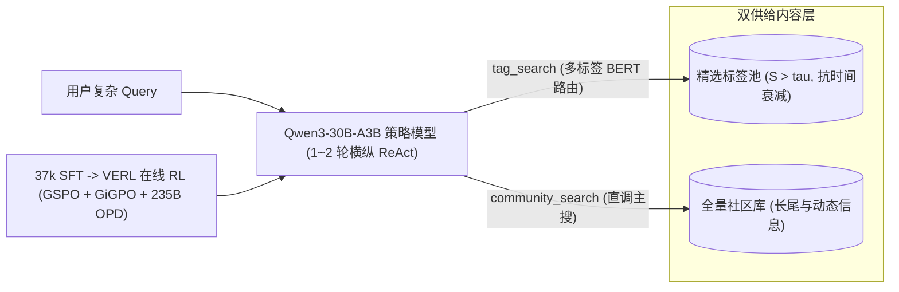

# 《Large Language Models》课程项目 Proposal（精简版）

## 项目名称
**基于标签增强双供给链路与多粒度强化学习的内容社区低时延 Agentic Search 系统**  
*Tag-Enhanced Dual-Supply and Multi-Granularity Reinforced Agentic Search for Low-Latency Content Communities*

---

## 摘要（Abstract）

在用户生成内容（UGC）社区中，面对旅行规划、影视推荐与消费决策等复杂查询，传统搜索引擎难以直接给出整合结论，而基于单一搜索接口的常规大模型 Agentic Search 则面临三大瓶颈：**信源相关性不等于决策有用性**（高价值长青内容随时间衰减下沉，早期召回噪声易引发多跳查询偏移）、**多轮串行推理与 C 端严苛响应时延冲突**，以及**稀疏混合专家（MoE）模型在跨轮交互中的信用分配与训推稳定性难题**。本项目拟设计并构建一套面向内容社区的低时延 Agentic Search 系统：（1）在供给侧，利用多模态离线蒸馏（`GPT-5.6` $\to$ `Qwen3-VL-32B`，结合 SFT 与 LUFFY-GRPO）自动构建三级标签体系，并通过 `Qwen3-VL-8B` 级联打标沉淀抗时间衰减的精选标签池，与全量搜索形成互补双工具（`tag_search` 与 `community_search`）；（2）在规划与数据侧，基于稀疏 MoE 基座 `Qwen3-30B-A3B` 设计“横向并行拆解 + 纵向多跳补查”的受限轮次（1～2 轮）ReAct 范式，融合线上会话日志 2-Gram 数据飞轮与 Rubric 多模型蒸馏构建高质量轨迹；（3）在强化学习侧，提出无价值网络（Critic-Free）的**“轨迹级（GSPO）+ 步骤级（GiGPO）+ 词元级（OPD）”三粒度加性优势优化框架**。项目将通过 500 题分层量表评测基准（RaR）与端到端时延（RT）消融实验，系统验证双供给架构与多粒度强化学习在回答质量与响应效率上的双重增益。

---

## 1. 研究背景与核心问题（Motivation & Problem Formulation）

内容社区海量帖子蕴含丰富的真实经验，但用户在解决多约束复杂需求时仍需反复改写搜索词并跨帖甄别分歧。将大语言模型升级为自主检索推理的 Search Agent 是破局关键，但在实际场景落地中亟待解决三个核心矛盾：

1. **信源供给矛盾（相关性 $\neq$ 有用性与时间衰减）**：常规社区搜索（`community_search`）强依赖发布时效与短期互动排序，导致社区规范、深度横评等长效优质信源随时间下沉；同时，UGC 中的营销软文与碎片化噪声一旦在首轮被召回，极易误导后续子查询改写，造成跨轮级联偏移。因此，亟需在开放全库检索之外建立一条**免疫时间衰减、围绕高频明确主题高精供给的结构化精选链路（`tag_search`）**。
2. **交互效率矛盾（推理深度 vs. C 端严苛时延）**：不同于可容忍十余轮串行调用的 B 端生产力 Agent，高并发 C 端搜索对首字时延（TTFT）与端到端耗时（RT）极为敏感，单次请求至多容忍 **1～2 轮 ReAct**。同时，小尺寸稠密模型（$<7\text{B}$）能力上限不足以支撑复杂拆解与冲突消解，而大尺寸稠密模型激活成本过高，需从**高总参、低激活的稀疏 MoE 架构**与**并行化查询动作空间**协同破局。
3. **策略优化矛盾（MoE 路由翻转与跨轮多粒度信用分配）**：Agentic Search 的前序检索动作直接改变后续观测状态。一方面，MoE 基座在异构训推引擎（`vLLM` vs. `Megatron-Core`）及策略多步复用下易发生**专家路由不一致（Expert Routing Mismatch）**，导致传统 Token 级重要性裁剪产生梯度碎片化；另一方面，单一终局奖励若均匀分配给全轨迹，既会错误强化冗余绕行的搜索步，也会在负分轨迹中误伤合规引用词元。如何在不引入高开销 Critic 网络的前提下实现多粒度精准归因，是核心算法问题。

---

## 2. 相关工作（Related Work）

- **RAG 与 Agentic Search**：以 ReAct、Search-R1 为代表的工作将静态单轮 RAG 推进至多轮自主检索，但普遍假设单一同质搜索引擎，缺乏针对 UGC 社区信源质量分化与时效下沉的**异构双供给协同路由**，亦较少针对 1～2 轮严苛时延预算优化并行拆解拓扑。
- **自动分类体系构建与多模态打标**：纯人工编纂分类树难以覆盖动态长尾话题，纯向量聚类则缺乏上位概念抽象能力。结合多模态大模型离线蒸馏与双向归纳成为主流方向；其中 **LUFFY** 通过在组采样中混入教师 Off-Policy 示范，有效缓解了低熵阶段组内奖励趋同引发的零梯度停滞。
- **大模型强化学习信用分配**：**GRPO** 以组内均值替代 Critic 基线，但在稀疏 MoE 上受困于 Token 级路由漂移；**GSPO** 将重要性比率提升至序列几何均值维度以平滑路由噪声；**GiGPO** 聚合共享中间锚点状态的轨迹组实现无 Critic 步骤级归因；**在线策略蒸馏（OPD）** 则通过冻结教师模型提供逐 Token 逆 KL 引导。本项目首次将三者统一于双链路 Agentic Search 后训练框架中。

---

## 3. 拟提出的方法框架（Proposed Methodology）

系统整体由**离线标签化供给链路**、**在线横纵双链路 ReAct 运行层**与**三粒度强化学习后训练框架**构成（图 1）。

### 3.1 双供给检索架构与三级标签体系构建
1. **开放兴趣点蒸馏与三级标签树归纳**：先由 `GPT-5.6` 采样 2.5 万条多模态 CoT 数据蒸馏 **`Qwen3-VL-32B`**（经 SFT 冷启动与 6:4 混合奖励的 **LUFFY-GRPO** 强化学习，混入教师满分轨迹消除全零优势）。利用蒸馏模型从千万级高热种子内容提取开放兴趣点，经去重与向量层次聚类沉淀出 24 万有效兴趣点；进而以业务专家定义的 **`50+` 一级标签（L1）** 为顶层锚点，通过“自顶向下挂载分类 + 自底向上异构多模型（GPT/Claude/Gemini）语义归纳与裁判反思”递归构建 **`700+` 二级标签（L2）** 与 **`5,000+` 三级标签（L3）**。
2. **离线非对称打标与在线轻量路由解耦**：采用综合点赞、收藏、转发、评论的加权准入公式 $S = w_l L + w_f F + w_s S_h + w_c C > \tau$ 筛选高价值内容（兼容官方权威信源置顶）。离线打标跳过二级模型以消除级联延迟与误差（保留 L2 类目作结构演进缓冲），基于 **`Qwen3-VL-8B`** 分别采用多模型投票蒸馏训练**一级打标模型**（1 万条全参 SFT）、采用三步 `<think>` CoT 蒸馏训练**三级打标模型**（2 万条全参 SFT，支持对未知新兴话题输出**`空白标签`**以触发标签树增量自演进）。在线检索时，`tag_search` 内部通过毫秒级**一级/三级多标签 BERT 分类器**将子查询路由至多组候选标签池并按相关性排序，与覆盖长尾实时动态的 `community_search` 形成互补（冲突时优先采信精选标签池）。

### 3.2 受限轮次横纵联合 ReAct 与轨迹合成飞轮
面向高并发低时延需求，核心策略基座选用 **`Qwen3-30B-A3B`**（总参数 30B 保障复杂推理容量，单 Token 仅激活 3B 控制推理开销），在最大 2 轮约束下协同两类动作：
- **横向 Action（并行拆解降时延）**：单轮内将多维意图拆解为一组并行 `sub_queries` 批量下发双工具，将多轮串行检索压缩为单轮并发；
- **纵向 Action（多跳补查保深度）**：依据首轮观测结果，针对信息缺失、观点冲突或具体时效条件发起第 2 轮靶向核实。

**训练轨迹制备（37,000 条）**遵循“先横后纵”管线：（1）**横向拆解数据飞轮**：解析线上用户连续搜索会话日志，经查询向量层次聚类归并同义表达后，挖掘 2-Gram 序列转移频次（高频转移习得“如何拆解”，低频出边习得“何时不拆”），经强模型质检后通过运行框架的 **`Checkpoint` 机制**原位注入替换子查询并向后重采样；（2）**纵向 Rubric 两阶段蒸馏**：融合标签树合成 Query 与真实日志 Query，先由多模型（`GLM-5.2` / `Kimi-K3` / `DeepSeek V4-Pro`）探索、`GPT-6 Astra` 融合元规则合成并经人工审校沉淀种子黄金轨迹，提炼类别级 **Trajectory Rubric** 与前向 **Query Hint**，再自动化批量扩充。训练时严格执行**因果损失掩码**，仅对模型生成的 `[Thinking]`、`[Input Decomposition]`、`[Action]`、`[Response]` 计算梯度，屏蔽系统提示词、用户输入与环境返回的 `[Tool Result]`。

### 3.3 无 Critic 三粒度加性优势 Agentic RL
在完整轨迹结束后结算防刷分**混合结果奖励**（全程按轮次/调用取均值聚合）：**10% 格式与多跳归因奖励**（JSON Schema 校验 + 正则约束 `"根据第 x 步"` 借助因果自注意力锚定前序观测）、**30% 查询相关性奖励**（逐轮评估子查询意图一致性）与 **60% 最终效果奖励**（解耦安全合规、社区语气、内联引用溯源 `[xxxx](ref: yyyy)` 与逻辑自洽，结合 PE + 全参 SFT + DPO 构建人机一致率 $\ge 95\%$ 的专用判别奖励模型）。

在单次 $G=8$ 组采样后，并行计算三层无 Critic 优势并加性融合：

$$\hat{A}_{i,t}^{\mathrm{total}} = \hat{A}_i^{E} + \omega \hat{A}_{i,t}^{S} + \lambda_{\mathrm{OPD}} \hat{A}_{i,t}^{\mathrm{OPD}}$$

1. **轨迹级优势（GSPO）**：针对 MoE 训推专家路由偏移，采用序列级几何平均概率比替代单 Token 概率比进行裁剪，无需底层路由回放即可显著缓解专家切换震荡与长序列方差（序列比率接近 1，裁剪区间取 GSPO 原文的 $3\times10^{-4}$ / $4\times10^{-4}$ 而非 $[0.8, 1.2]$）。三粒度优势随步骤与词元变化，策略更新采用 **GSPO-token** 形式（裁剪仍看序列比率，梯度按词元携带各自优势）：

$$s_i(\theta) = \exp\!\left(\frac{1}{|y_i|}\sum_{t=1}^{|y_i|} \log \frac{\pi_\theta(y_{i,t}\mid x, y_{i,<t})}{\pi_{\theta_{\mathrm{old}}}(y_{i,t}\mid x, y_{i,<t})}\right), \qquad \hat{A}_i^E = \frac{R_i - \bar{R}}{\sigma_R + \epsilon}$$

2. **步骤级优势（GiGPO）**：严格界定**锚点状态 $\tilde{s}$ 为决策前已持有的检索帖子集合**，**动作 $a_{i,t}$ 为当前发出的搜索 `query`**。跨轨迹聚合相同状态决策点 $\mathcal{B}(\tilde{s})$，计算步数折扣回报 $Q_{i,t} = \gamma^{T_i - t} R_i$ 并在锚点组内标准化得到 $\hat{A}_{i,t}^S$，精准激励以更少步数达成高质量回复的高效查询。
3. **词元级优势（OPD）**：部署冻结的异构教师模型 **`Qwen3-235B-A22B`**（独立 `vLLM` 服务，与学生共享 Qwen3 词表），对学生生成轨迹执行单次并行 Teacher Forcing，基于采样词元逆 KL 散度 $\hat{A}_{i,t}^{\mathrm{OPD}} = \log \pi_T(y_{i,t}\mid c_{i,t}) - \log \pi_{\theta_{\mathrm{old}}}(y_{i,t}\mid c_{i,t})$ 提供细粒度信号，精准惩罚漏掉关键约束词或冗余摇摆思考，同时保护负分轨迹中的正确引用与合规表述。

---

## 4. 实验设置与评测方案（Experimental Setup & Evaluation Plan）

### 4.1 训练配置与系统工程保障
- **全参 SFT 阶段**：基于 `ms-swift`（`Megatron-SWIFT` 后端），使用 **37,000 条**完整轨迹对 `Qwen3-30B-A3B`（每层 128 个专家）采用 **专家并行 EP=8**（16× A800 80GB，BF16 + 梯度检查点）进行全参微调。
- **在线 RL 阶段**：从 SFT 权重初始化，基于 `VERL + Megatron-Core + vLLM` 在 **10,000 条**复杂去重 Query（每题采样 $G=8$ 条轨迹）上进行全参强化学习（32× A800 80GB + 独立 `Qwen3-235B-A22B` 教师节点）。
- **训练专用搜索代理层**：为化解 $8$ 路并发 Rollout 叠加横向多子查询引发的瞬时检索脉冲风暴，在 `VERL` 与后端检索服务间增设代理层，集成**有界队列背压、按工具全局限流、精确键缓存与在途请求合并（Singleflight）**，并严格区分“真实检索无结果”与“基础设施超时故障”以免污染奖励信号。

### 4.2 评测体系与消融实验设计
1. **RaR（Rubrics as Rewards）评分量表分层评测基准**：构建涵盖高频/长尾、多硬约束、横纵拆解与证据冲突等场景的 **500 条评测集**及逐题专属量表，划分为三层：**P0 硬性要求**（明确可量化约束违反、伪造信源或违规红线实行一票否决系数 $G_{\mathrm{P0}} \in \{0, 1\}$）、**P1 搜索过程（40 分）**（格式规范与执行一致性 10 分 + 查询相关性/横向覆盖/纵向停止 30 分）、**P2 回答质量（60 分）**（需求覆盖 20 分 + 引用支撑 20 分 + 可执行性 10 分 + 社区表达与不确定性处理 10 分）。最终得分 $S_{\mathrm{final}} = G_{\mathrm{P0}} \times (F+Q+A)$，以 **$G_{\mathrm{P0}}=1 \land S_{\mathrm{quality}} \ge 80$** 判定任务通过。
2. **核心消融与性能验证矩阵**：
   - **训练阶段递进消融**：对比 `未训练基座` $\to$ `+SFT` $\to$ `+GSPO` $\to$ `+GSPO+GiGPO+OPD` 在 500 题 RaR 基准上的通过率演进（目标由基座 `<40%` 阶梯式提升至 `~80%`）及 P1/P2 子项收益分解；
   - **双供给与动作拓扑消融**：对比单路 `community_search` 与双供给协同的长青信源召回质量，以及“无横向 Action”与“有横向 Action”在调用轮次（目标由 ~4 轮降至 1～2 轮）和端到端 RT（目标由 ~15s 降至 ~6s）上的延迟收益；
   - **`pass@1` 与 `pass@k` 失败归因诊断**：在独立诊断集上执行 32 次采样对比 `pass@1 / pass@8 / pass@16`，将“高 `pass@k` 低 `pass@1`”样本分流至 RL 稳定策略分布，将“双低且教师可解”样本回流补充 SFT，将“教师亦不可解”样本定位至检索覆盖与量表修复。

---

## 5. 预期贡献与实施路线（Expected Contributions & Roadmap）

### 5.1 预期项目贡献
1. **架构层面**：提出“离线 VLM 深度打标沉淀长青精选池 + 在线轻量多标签 BERT 毫秒路由 + 全库动态补查”的双供给 Agentic Search 架构，兼顾信源质量与低时延召回。
2. **数据与交互层面**：构建受限轮次横纵联合 ReAct 范式，结合线上搜索会话 2-Gram 数据飞轮与 Rubric 两阶段轨迹蒸馏，显著压缩端到端响应延迟。
3. **算法与评测层面**：提出面向稀疏 MoE 模型的 `GSPO + GiGPO + OPD` 无 Critic 三粒度强化学习方案，并建立配套的 RaR 百点评测与 `pass@k` 诊断闭环（后续亦可进一步探索自进化标签构建 Harness、Jev 免裁剪分类架构与流式“边生成边搜索”）。

### 5.2 项目实施路线与里程碑（Implementation Roadmap）

| 实施阶段 | 核心研究与开发模块 | 关键里程碑交付物 |
| :--- | :--- | :--- |
| **Phase 1：问题建模与评测基准** | 定义双供给工具 Schema；构建 500-Query 多场景评测集与 P0/P1/P2 RaR 自动评测管线 | 工具接口规范、500 题 RaR 评测集与并行 Judge 评测脚本 |
| **Phase 2：三级标签与双供给服务** | 完成 `Qwen3-VL-32B` 兴趣提取蒸馏与三级标签树构建；训练 L1/L3 `Qwen3-VL-8B` 打标模型与在线多标签 BERT 路由 | 完整三级标签体系、精选标签内容池与双供给检索 API |
| **Phase 3：运行框架与轨迹合成** | 搭建支持 `Checkpoint` 与 `LLM Provider` 的 ReAct 框架；跑通会话 2-Gram 飞轮与 Rubric 蒸馏，构建 37k SFT 轨迹 | 双层 Agent 运行框架、带精确损失掩码的 37k 训练数据集 |
| **Phase 4：MoE SFT 与多粒度 RL** | 完成 `Qwen3-30B-A3B` 全参 SFT（EP=8）；部署搜索代理层与专用 RM，在 `VERL` 上完成 GSPO + GiGPO + OPD 训练 | SFT 基线模型、训练搜索代理层、多粒度 RL 各阶段策略权重 |
| **Phase 5：消融验证与结题报告** | 完成 RaR 通过率、RT 时延与双供给消融实验；开展 32-Rollout `pass@1 / pass@k` 归因分析；撰写结题报告 | 完整消融实验分析、Badcase 诊断矩阵、结题论文与系统演示 |
