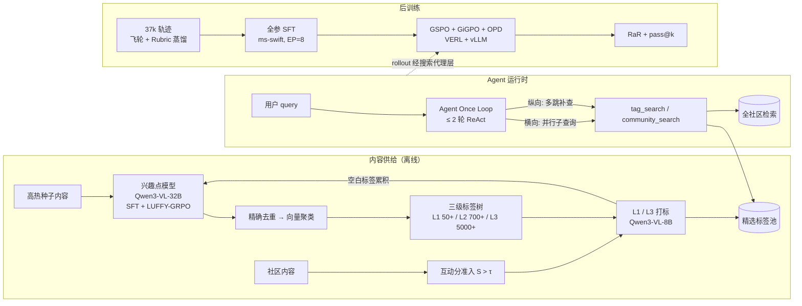

# agentic-search

**基于标签增强双供给链路与多粒度强化学习的内容社区低时延 Agentic Search**

面向小红书/抖音"问一问"类产品的搜索 Agent：用户只说需求，Agent 在 1~2 轮 ReAct 内完成需求拆解、
双链路检索、证据核实与带引用的回答。本仓库实现了项目的完整算法栈：

- **内容供给**：兴趣点提取（SFT + LUFFY-GRPO）→ 去重/聚类漏斗 → 自顶向下 + 自底向上三级标签树 → L1/L3 打标与互动分准入 → `tag_search`；与全社区 `community_search` 组成双供给。
- **数据**：横向 Action（并行子查询）+ 纵向 Action（多跳补查）的 ReAct 轨迹；线上会话 2-gram 数据飞轮 + Checkpoint 注入；Rubric 两阶段蒸馏；严格损失掩码。
- **训练**：格式 / query 相关性 / 最终效果三段式混合奖励；**GSPO（轨迹）+ GiGPO（步骤）+ OPD（token）** 三粒度无 Critic 优势；训练专用搜索代理层。
- **评测**：RaR 分层百分制（P0 红线门控 + P1/P2）与 pass@1 / pass@k 的 SFT-vs-RL 分流。

> 项目方案见 [PROPOSAL.md](PROPOSAL.md)；公式与工程取舍见 [docs/algorithms.md](docs/algorithms.md)；
> 6 人小组分工见 [docs/team_roles.md](docs/team_roles.md)，配套的分角色教程（含可运行例子）见 [docs/tutorial.md](docs/tutorial.md)。

## PROPOSAL 报告的结果

以下数字来自 PROPOSAL 表 3、表 4（Qwen3-30B-A3B，500 条 RaR 基准），**本仓库没有在 GPU 上复现**：

| 版本 | RaR 通过 | 通过率 |
|---|---:|---:|
| Qwen3-30B-A3B 未训练 | 188 / 500 | 37.6% |
| + 全参 SFT（37k 轨迹） | 337 / 500 | 67.4% |
| + GSPO | 377 / 500 | 75.4% |
| + GSPO + GiGPO + OPD | 396 / 500 | 79.2% |

引入横向 Action 后，平均工具轮次 4 → 1~2，端到端时延 15 s → 6 s。

## 架构



## 仓库结构

```
src/agentic_search/
  core/          Trajectory / Step / Post 数据模型（Step.state_post_ids = GiGPO 锚点状态）；分词、BM25、哈希 embedding
  algos/         纯 PyTorch：组内标准化、GiGPO、OPD、优势组合；GSPO-token、PPO、LUFFY 损失
  rewards/       格式奖励、query 相关性、最终效果（单维度裁判 + 引用闸门）、混合奖励
  runtime/       Main Loop / Agent Once Loop、轮次预算、Checkpoint、LLM Provider、动态 few-shot
  tools/         双供给工具、级联 L1→L3 路由、训练专用搜索代理（背压/限流/singleflight/精确缓存/重试/监控）
  taxonomy/      兴趣点奖励、漏斗、标签树构建器、准入与空白标签监控
  data/          会话飞轮、Rubric 两阶段蒸馏、SFT 导出与 token 级掩码
  eval/          RaR 评测、pass@k 与 badcase 分流
  integrations/verl/   VERL 优势钩子、OPD 教师打分、token 级 agent loop、reward 入口
configs/         agentic_search.yaml（运行时/工具/代理/奖励/优势/教师/评测）、taxonomy.yaml、flywheel.yaml、verl/
scripts/         sft/（ms-swift Megatron）、rl/（VERL）、serve/（教师 vLLM）
docs/            算法说明、RL 上线前检查、6 人分工、分角色教程
tests/           CPU 单测（含逐段执行 docs/tutorial.md 的代码）
```

## 快速开始

```bash
uv venv --python 3.12 && uv pip install -e ".[dev]"
```

```bash
make check            # ruff + mypy + pytest
```

```bash
uv run agentic-search demo           # 离线端到端：三条 rollout → 混合奖励 → 轨迹级 + 步骤级优势
```

```bash
uv run agentic-search gigpo-example  # 复现 GiGPO 三轨迹算例（−1.357 / +0.332 / +1.024 …）
```

```bash
uv run python examples/quickstart.py
```

`demo` 的输出示例（同一 query 的三条 rollout；三者第 2 步持有的帖子集合相同，GiGPO 直接比较"先核实""直接回答""跑题补查"三种动作）：

```
policy                 rounds  format  query  outcome      R     A^E   A^S per step
horizontal+vertical         2    1.00   1.00     1.00  1.000   +1.17   [+0.89 +0.89 +0.00]
horizontal only             1    1.00   1.00     0.75  0.850   +0.10   [+0.51 +0.51]
drifting                    2    0.60   0.50     0.75  0.660   -1.27   [-1.40 -1.40 +0.00]
```

## 训练流程

GPU 依赖通过 `pip install -e ".[train]"` 安装（verl、ms-swift、vllm，仅 Linux）。硬件与数据规模均为 PROPOSAL §5.1 的设定。

| 阶段 | 内容 | 入口 | PROPOSAL 设定 |
|---|---|---|---|
| 1 | 兴趣点模型：GPT-5.6 蒸馏 CoT → SFT → LUFFY-GRPO（RLAIF:RLVR = 6:4） | `algos.luffy_loss`、`taxonomy.interest_point_reward` | Qwen3-VL-32B；SFT 8×H100 ~1 天，RL 16×H100 ~2 天 |
| 2 | 漏斗与三级标签树 | `taxonomy.run_funnel`、`TaxonomyBuilder` | 1000万+ 种子 → 24万+ 有效兴趣点 |
| 3 | L1 / L3 打标与准入 | `AdmissionController`、`BlankTagMonitor`、`configs/taxonomy.yaml` | Qwen3-VL-8B，1 万 / 2 万条，4×A100 |
| 4 | SFT 轨迹：飞轮 + Rubric 蒸馏 | `agentic-search mine-flywheel`、`data.first_pass/second_pass`、`data.export_sft_jsonl` | 37,000 条 |
| 5 | 全参 SFT | `scripts/sft/run_qwen3_30b_a3b_megatron.sh` | Qwen3-30B-A3B，16×A800，24h，EP=8 |
| 6 | 教师服务 | `scripts/serve/teacher_vllm.sh` | Qwen3-235B-A22B |
| 7 | 在线 RL | `agentic-search build-rl-data` → `scripts/rl/run_gspo_gigpo_opd_qwen3_30b_a3b.sh` | 1 万 query × 8，32×A800，72h |
| 8 | 评测与分流 | `eval.RaREvaluator`、`eval.diagnose` | 500 条 RaR；每 query 32 次采样 |

开长跑之前先按 [docs/rl_debug_protocol.md](docs/rl_debug_protocol.md) 过三阶段检查。

## 关键设计决策

以下几处在实现时需要明确取舍，推导见 [docs/algorithms.md](docs/algorithms.md)：

1. **GSPO 与 token 级优势**：GiGPO / OPD 的优势随步骤、token 变化，使用 GSPO-token 形式；序列内优势为常数时与 GSPO 严格等价（有梯度级单测）。
2. **GSPO 裁剪区间**取 3e-4 / 4e-4（GSPO 论文设置），而非 token 级 PPO 惯用的 0.8 / 1.2——后者作用在几何平均比率上几乎不触发。
3. **奖励权重**默认 10/30/60，与 RaR 评测的 F10/Q30/A60 同尺度，可在配置中调整。
4. **工具调用格式**统一为模型生成 `[{"name","arguments"}]`，`call_id` 由运行时分配；列表式简写（`name` 为工具列表 + `sub_queries`）会自动展开为原子调用。
5. **GiGPO 的状态/动作**按 PROPOSAL §4.3(2) 的界定：状态 = 已持有的帖子集合，动作 = query。
6. **OPD** 要求师生同词表（Qwen3 家族满足）；OPD 权重记作 `lambda_opd`，与 GiGPO 的折扣 γ 区分。

## 验证范围

| 部分 | 状态 |
|---|---|
| `core` `algos` `rewards` `runtime` `tools` `taxonomy` `data` `eval` | CPU 单测覆盖（共 110 个，含逐段执行教程代码），ruff 与 mypy 通过 |
| `integrations/verl/advantage.py` 的张量函数 | 单测覆盖 |
| VERL 钩子与 agent loop、OPD 教师客户端、`scripts/` 下的启动脚本 | 参考实现，按 VERL 0.6 / ms-swift 3.x 接口编写，**未在 GPU 环境运行**；升级框架时请核对字段名 |
| 真实模型、搜索服务、裁判 / RM | 通过 `configs/agentic_search.yaml` 中的端点接入，仓库内只有离线替身（`agentic_search.demo`） |

## 开发约定

- `src/` 布局，`uv` 管理环境；`make check` = ruff + mypy + pytest；CI 在 CPU 上跑同样的检查和 demo。
- 算法核心保持框架无关（纯 PyTorch），训练框架相关代码只放在 `integrations/`。
- 所有 LLM 角色（策略、裁判、归纳器、挂载器）都是协议接口，测试使用确定性替身。

## 参考文献

- Zheng et al. *Group Sequence Policy Optimization.* arXiv:2507.18071
- Feng et al. *Group-in-Group Policy Optimization for LLM Agent Training.* arXiv:2505.10978
- Yan et al. *Learning to Reason under Off-Policy Guidance (LUFFY).* arXiv:2504.14945
- Agarwal et al. *On-Policy Distillation of Language Models.* arXiv:2306.13649；Thinking Machines Lab, *On-Policy Distillation*, 2025
- Shao et al. *DeepSeekMath (GRPO).* arXiv:2402.03300
- Gunjal et al. *Rubrics as Rewards.* arXiv:2507.17746
- Yao et al. *ReAct.* arXiv:2210.03629；Jin et al. *Search-R1.* arXiv:2503.09516
- Chen et al. *Evaluating Large Language Models Trained on Code（pass@k 无偏估计）.* arXiv:2107.03374
- Sheng et al. *HybridFlow (verl).* arXiv:2409.19256
